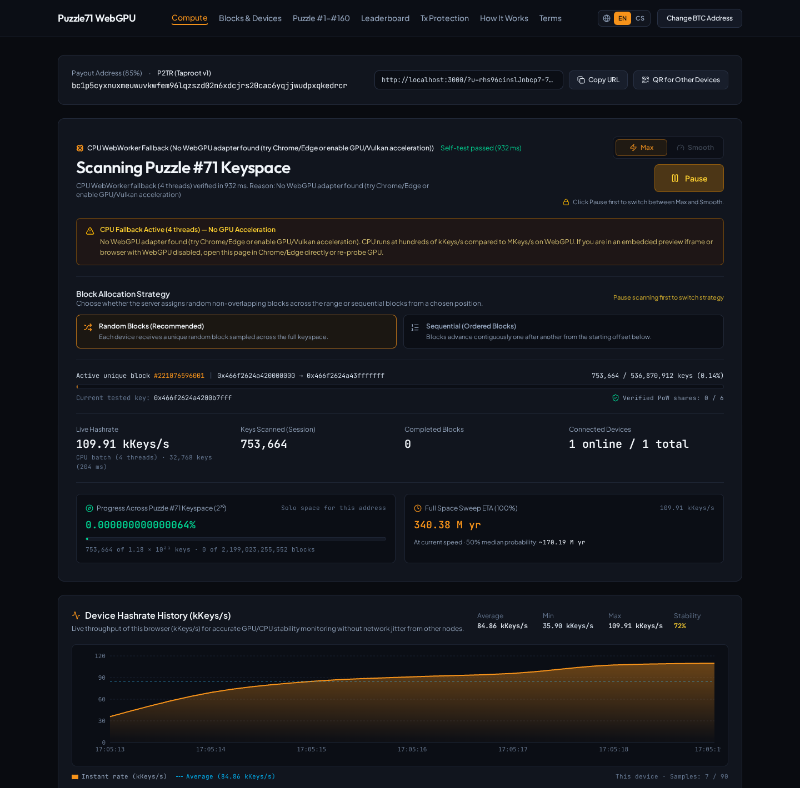
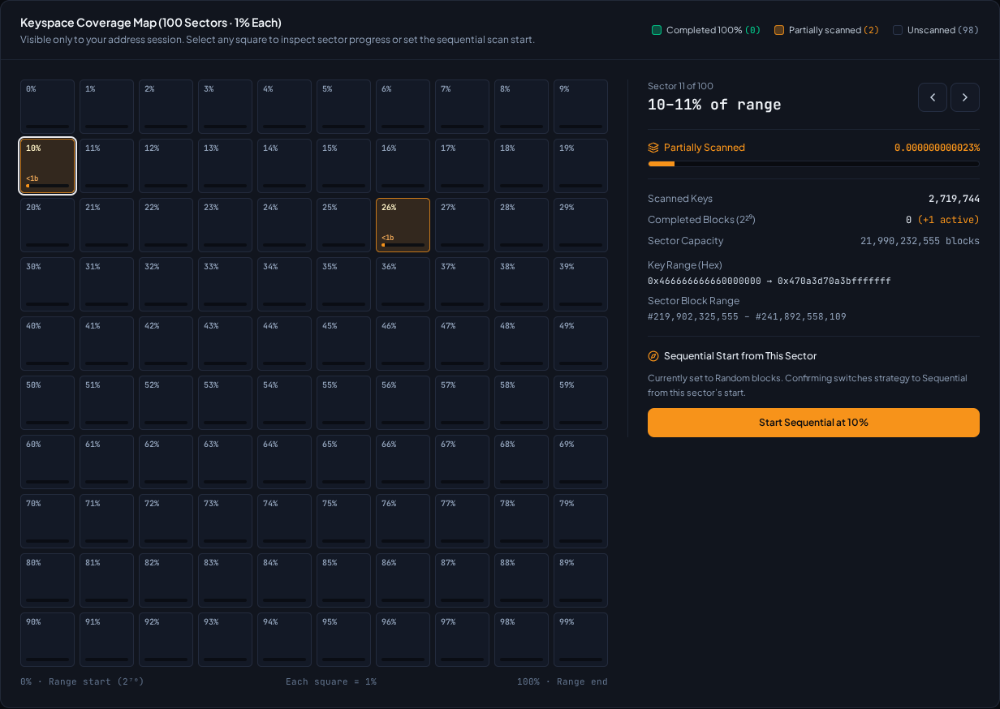
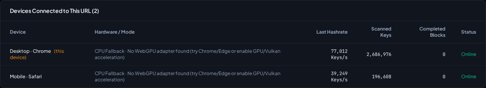
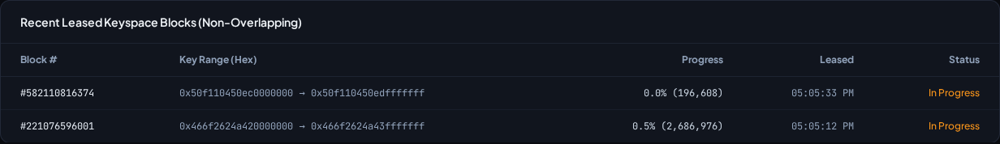

# Bitcoin Puzzle #71 — Zero-Install Browser WebGPU Solver & #1–#160 Key Directory

> **Educational & Cryptographic Research Project** — Run a high-speed **WebGPU** `secp256k1 + Hash160` key-space explorer for **Bitcoin Puzzle #71 (7.10 BTC)** directly in your browser with **zero installation**. Works on **Windows, Linux, macOS, iPhone, and Android**, featuring non-overlapping multi-device `2²⁹` block coordination, local browser `85% / 15%` payout signing, private mining-pool submission (RBF front-running protection), and a cryptographically verified **Bitcoin Puzzle #1–#160** directory & ETA calculator.

### Live Web App

Open the website and start scanning in seconds — **nothing to download, compile, or install**:
**[https://btc-puzzle71.ai.studio/](https://btc-puzzle71.ai.studio/)**

*(Bilingual UI: English default `/` and Czech `/cs` switcher built in. Zero browser cookies or localStorage tracking.)*

---

## Screenshots & Visual Tour

### 1. Live Scanning Console (`Compute`)


**What it shows:** The main real-time solver console running directly in the browser with zero installation. It displays the active payout address (`P2PKH`, `P2SH`, `Bech32`, or `Taproot`), your shareable multi-device URL & QR code, `Max` / `Smooth` execution profiles, **Random** vs. **Sequential** block allocation, the currently leased `2²⁹` keyspace block (`536,870,912` keys), currently tested hexadecimal private key, verified Proof-of-Work shares, live hashrate, full-space ETA, and the per-device throughput chart.

---

### 2. Visual Keyspace Coverage Map (`100 Sectors · 1% Each`) — Private to Your Session


**What makes it unique:** Most key-search tools give you only a raw text counter and never show *where* in the `2⁷⁰` range your machines have actually been. Only visible to holders of your private session URL, the **Keyspace Coverage Map** divides the entire Puzzle `#71` space into a **10 × 10 grid of 100 sectors (`1%` each)**:
- **Green:** `100%` completed sector.
- **Orange (with fill bar & progress indicator):** Partially scanned sector.
- **Dark slate:** Completely unscanned sector.

Click any square to inspect its exact **hexadecimal key bounds**, **block range**, **scanned key count**, and **completion percentage** — and click **`Start Sequential at X%`** to jump sequential scanning straight to any sector you choose.

---

### 3. Simultaneous Multi-Device Coordination (Same URL, Zero Duplicate Work)




**What makes it unique:** Open your personal session URL (or scan the QR code) on your **desktop GPU, laptop, and smartphone** at the same time — in the example above, `Desktop · Chrome` and `Mobile · Safari` compute simultaneously under the same address. The server tracks every device's live hashrate, key count, and online heartbeat while leasing **strictly non-overlapping `2²⁹` keyspace blocks** (`#582110816374` vs. `#221076596001` above). **It is guaranteed that two connected devices — or two runs on your own machines — will never waste compute scanning the same keyspace range more than once.**

---

## Why Use Browser WebGPU Instead of Complicated CLI Setups?

- **Zero Installation — Just Open & Compute:** No CUDA toolkit downloads, no Visual Studio build tools, no Python dependencies, and no terminal scripts. Simply open the web page, enter your public Bitcoin payout address, and click **Start**.
- **True Cross-Platform Support (Desktop & Mobile):**
  - **Windows** (Chrome / Edge WebGPU & multi-core CPU fallback)
  - **Linux** (Chrome / Chromium Vulkan WebGPU & CPU WebWorkers)
  - **macOS** (Safari / Chrome on Apple Silicon M1–M4 & Intel Macs)
  - **Smartphones & Tablets** (**iPhone / iOS** & **Android** — pool your phone, laptop, and desktop together!)
- **Multi-Device Solo Link & QR Code:** Every public Bitcoin address gets a unique shareable session URL so all of your PCs, laptops, and phones scan **non-overlapping `2²⁹` blocks** without repeating work.
- **Max & Smooth Compute Profiles:** Run at **Max** for full dual-queue GPU/CPU throughput, or switch to **Smooth** (when paused) to keep scrolling and everyday browser tasks responsive with only a few percent speed difference.

---

## Approximate Hardware Performance Reference (`MKeys/s`)

> **Important Performance Disclaimer (Not Guaranteed):**
> All figures below are **rough real-world and community reference estimates — NOT guaranteed throughput**. Actual `MKeys/s` on your machine can differ significantly depending on WebGPU browser implementation (Chrome/Edge Dawn DX12/Vulkan vs. Safari Metal vs. bare-metal CUDA), GPU drivers, exact chip variant (desktop vs. laptop power limits), thermal throttling, OS background load, and `Max` vs. `Smooth` mode. Use the live app's built-in **self-test** and **ETA calculator** to measure your exact device rate.

### Measured Browser WebGPU Examples (Apple Silicon & Mobile)

| Device / Chip | Execution Mode | Approximate Speed | Notes |
| --- | --- | --- | --- |
| **Apple iPhone** *(depends on model)* | Browser WebGPU | **~6 MKeys/s** | Varies by SoC generation (A-series GPU cores), iOS version, and thermal state |
| **Apple MacBook (M4 chip)** | Browser WebGPU | **~56 MKeys/s** | Varies across base M4 / M4 Pro / M4 Max core counts and power mode |

### Popular NVIDIA GeForce RTX Cards (Community Reference in Similar Tools)

The table below shows approximate throughput reported across community benchmarks for popular **NVIDIA RTX** GPUs in native CUDA `secp256k1 + Hash160` key-search tools (such as *BitCrack*, *VanitySearch* forks, and *KeyHunt* variants). **Browser WebGPU throughput on the same GPU is typically lower than dedicated native CUDA binaries** due to browser sandbox, shader translation (WGSL → DXIL/SPIR-V), and OS compositor overhead:

| NVIDIA GPU Model | Typical Native CUDA Reference (*BitCrack / VanitySearch* class) | Notes |
| --- | --- | --- |
| **GeForce RTX 3060** | **~350 – 600 MKeys/s** | Entry Ampere desktop/laptop tier; depends heavily on kernel optimization |
| **GeForce RTX 3070** | **~900 – 1,050 MKeys/s** | Mid-range Ampere GPU benchmarks in compressed Hash160 scans |
| **GeForce RTX 3080** | **~1,100 – 1,600 MKeys/s** | High-end Ampere GPU; varies by memory/power limits and batch inversion |
| **GeForce RTX 3090** | **~2,500+ MKeys/s** | Flagship Ampere card (`~2.5 GKeys/s` in optimized CUDA solvers) |
| **GeForce RTX 4070** | **~2,100+ MKeys/s** | Ada Lovelace efficiency closely rivals older flagship tier |
| **GeForce RTX 4090** | **~2,600 – 5,900+ MKeys/s** | Top Ada Lovelace consumer GPU (`2.6–5.9+ GKeys/s` depending on kernel) |
| **GeForce RTX 5090** | **~8,000+ MKeys/s** | Blackwell flagship (`8+ GKeys/s` reported in top community puzzle pools) |

---

## Important Disclaimer & Risk Notice

**Read carefully before using this software or visiting the live deployment:**

- **Vibecoding & AI-Generated Code (Unreviewed):** This entire project was built using the **vibecoding** workflow in **Google AI Studio**. **All source code was generated by AI and has not yet been reviewed or audited by a human programmer.** Inspect the code independently before running it or relying on any cryptographic or transaction logic.
- **Strictly Educational & Experimental:** This repository and web application are provided solely for educational, scientific, and experimental study of `secp256k1` elliptic-curve arithmetic, `SHA-256` / `RIPEMD-160` hashing, browser WebGPU compute shaders, and Bitcoin mempool front-running defenses.
- **No Warranty ("AS-IS"):** The software is provided **"AS-IS"** and **"AS-AVAILABLE"** without any express or implied warranties, including no guarantee of finding any private key, earning any financial return, balance availability on target addresses, or uninterrupted uptime.
- **User Assumes All Risks:** By running any computation in your browser or self-hosting this code, **you assume 100% of all technical, hardware, financial, and legal risks**, including:
  - **Extreme mathematical odds:** Puzzle #71 spans `2⁷⁰` (`1,180,591,620,717,411,303,424`) possible private keys; statistically, there is no guarantee a key will ever be found by your hardware.
  - **Hardware wear & power costs:** Sustained WebGPU and multi-threaded CPU workloads heavily load graphics chips, memory, VRMs, and cooling systems, carrying thermal throttling and hardware degradation risks—especially on laptops and mobile devices. All electricity and compute costs are solely yours.
  - **Payout address & third-party risks:** You are solely responsible for the accuracy of the public Bitcoin payout address you enter and for any interaction with external block explorers or private mining-pool APIs.
- **Never Enter Personal Wallet Secrets:** Never input seed phrases (12/24 words) or private keys belonging to your personal wallets. Only a **public** Bitcoin payout address is used to identify your session.

---

## What It Does

### 1. In-Browser WebGPU Compute Engine (with CPU Fallback)
- Runs **WGSL compute shaders** directly on your GPU inside modern WebGPU browsers—no CUDA/OpenCL binary downloads required.
- Combines precomputed `secp256k1` generator `G` tables, symmetric point addition (`P ± k·G`), Montgomery batch modular inversion, and inline `SHA-256` + `RIPEMD-160` (`Hash160`) comparison inside the shader.
- Automatically runs a **cryptographic self-test** against a known reference key before scanning starts.
- Falls back cleanly to **multi-threaded CPU WebWorkers** when WebGPU adapters are unavailable.

### 2. Multi-Device Non-Overlapping `2²⁹` Block Coordination
- Partitions the 71-bit range (`0x400000000000000000` → `0x7fffffffffffffffff`) into `2⁴¹` uniform **`2²⁹` blocks** (`536,870,912` keys per block).
- Entering your public Bitcoin address generates a unique shareable session URL (and QR code) so you can connect multiple GPUs, PCs, or phones without duplicating work.
- Supports **Random** sampling or **Sequential** scanning from any starting percentage (`0%`–`99.9%`), adaptive contiguous batch leasing (`1–8` blocks) based on measured GPU speed, pause keep-alive heartbeats, and server-verified **Proof-of-Work shares** (`Hash160` prefix `000000`) before marking blocks complete.

### 3. Local Browser Signing (`85% / 15%`) & RBF Front-Running Protection
- Supports every Bitcoin mainnet address format: **Legacy P2PKH** (`1…`), **P2SH** (`3…`), **SegWit v0 Bech32** (`bc1q…`), **Taproot v1 Bech32m** (`bc1p…`), and future witness versions `v2–v16`.
- If a winning key is ever discovered, the raw spend transaction is built and signed **strictly inside your browser** (`SIGHASH_ALL`, `low-S` via `@noble/curves`)—the candidate private key never leaves your device.
- After deducting the priority miner fee, outputs split **85%** to your payout address and **15%** to the platform maintenance address.
- **Private Pool Relay Only:** Because Puzzle #71 (`1PWo3JeB9jrGwfHDNpdGK54CRas7fsVzXU`) has never exposed its public key on-chain, broadcasting to the public mempool would let bots extract the public key, crack the 71-bit scalar via Pollard's Kangaroo, and RBF-hijack the transaction. Signed transactions are routed exclusively to private mining-pool endpoints (**MARA Slipstream** & **Rebar Shield**, plus an optional custom pool RPC).
- Includes a safe **Dry-Run Signing & Relay Inspector** (`/transaction-protection`) and an end-to-end **Demo Puzzle #5** walkthrough inside the console.

### 4. Verified Bitcoin Puzzle #1–#160 Directory & ETA Calculator
- Complete dataset of all **160** Bitcoin Puzzle Transaction addresses (`988.498 BTC` total: `83` solved totaling `85.498 BTC`, `77` unsolved holding `903 BTC`), including solved hex keys, discovery dates, solve positions (`%`), public-key exposure indicators (`Hash160` vs. `PubKey`), and milestone history.
- Interactive **Difficulty & ETA Calculator** allowing users to benchmark any puzzle `#1–#160` against their live WebGPU rate or hardware presets (`CPU`, `Laptop GPU`, `RTX 4090`, `Cluster`).
- Public anonymized **Solo Leaderboard** displaying masked address prefixes/suffixes, server-verified key counts, completed blocks, and exact decimal percentage progress.

---

## Tech Stack

- **Frontend:** React 19, TypeScript, Vite, Tailwind CSS, Lucide Icons, Recharts, `qrcode.react`
- **Cryptography:** `@noble/curves` (`secp256k1`), `@noble/hashes` (`SHA-256`, `RIPEMD-160`), `@scure/base` (`Bech32` / `Bech32m` / `Base58Check`), custom WebGPU WGSL shaders & CPU WebWorkers
- **Backend & Storage:** Node.js, Express, SQLite (`better-sqlite3` with strict PoW validation and parameterized queries)

---

## Running Locally

### Prerequisites
- Node.js `>= 20`
- A modern browser with WebGPU support (Chrome / Edge / Brave) for GPU acceleration, or any modern browser for multi-threaded CPU WebWorker mode.

### Setup & Development
```bash
git clone <your-repo-url>
cd <repo-folder>
npm install
npm run dev
```
The app and API server start on `http://localhost:3000`.

### Production Build & Start
```bash
npm run build
npm start
```

### Run Tests & Type Check
```bash
npm run lint
npx tsx --test \
  src/i18n/locale.test.ts \
  src/utils/keyspaceStats.test.ts \
  src/data/bitcoinPuzzles.test.ts \
  src/shared/crypto.test.ts \
  src/utils/speedHistory.test.ts \
  src/engine/selfTest.test.ts \
  server/db.test.ts
```

### Optional Server Environment Variables
No environment variables or API keys are required to run the app. All optional overrides live server-side in `.env` (see `.env.example`):
- `SLIPSTREAM_API_URL` — Custom MARA Slipstream REST endpoint
- `REBAR_SHIELD_RPC_URL` — Custom Rebar Shield JSON-RPC endpoint
- `CUSTOM_POOL_RPC_URL` — Optional third private pool JSON-RPC endpoint
- `CUSTOM_POOL_AUTH_HEADER` — Optional server-only `Authorization` header for the custom pool RPC
- `DATABASE_PATH` — Path to the SQLite database file (defaults to `./data/puzzle71.db`, excluded via `.gitignore`)

---

## Project Structure

```text
docs/
  screenshots/      English UI screenshots embedded in README.md
src/
  components/       UI views (Onboarding, ComputeConsole, PuzzleDirectorySection, LeaderboardSection, RelayInspector, HowItWorks, LegalTerms)
  data/             Verified Bitcoin Puzzle #1–#160 dataset & timeline
  engine/           WebGPU WGSL shader compute engine, CPU worker, and cryptographic self-tests
  i18n/             Bilingual EN/CS routing, formatters, and dynamic SEO metadata
  shared/           Bitcoin address validation, transaction builder/signer, Puzzle #71 math & block bounds
  utils/            Device ID helpers, speed history stats, keyspace ETA/percentage formatters
server/
  db.ts             SQLite session, device, block-lease, and PoW verification store
  privateRelay.ts   Mempool.space / Blockstream UTXO lookup & private mining-pool relay
  routes.ts         Express API routes, bilingual sitemap.xml & robots.txt
server.ts           Express + Vite server entrypoint
```

---

## Frequently Searched Questions (Bitcoin Puzzle #71 & WebGPU)

- **Can I really search Bitcoin Puzzle #71 keys without installing software?**
  Yes. Modern browsers expose GPU compute shaders through the **WebGPU API**. This app compiles a custom `secp256k1 + SHA-256 + RIPEMD-160` WGSL compute pipeline straight inside your tab on Windows, Linux, macOS, iOS, or Android—and automatically uses multi-threaded CPU WebWorkers if WebGPU is unavailable.
- **How does this compare to BitCrack, KeyHunt, or RCKangaroo?**
  - **BitCrack / KeyHunt:** Native CUDA/C++ CLI tools best suited for dedicated bare-metal GPU rigs targeting Hash160 puzzles (`#71–#74`).
  - **RCKangaroo / Pollard's Kangaroo:** `O(√N)` solvers designed for puzzles with **exposed public keys** on-chain (`#140, #145, #150, #155, #160` — **cannot** be used on Puzzle `#71` until an outgoing spend reveals its public key).
  - **Puzzle71 WebGPU (this project):** Instant zero-install web app combining multi-device block coordination, public solo leaderboard, verified `#1–#160` dataset, and private pool RBF-safe transaction signing.
- **Does anything get saved in browser cookies or localStorage?**
  No. The app operates with zero `localStorage`, `sessionStorage`, `cookies`, or `IndexedDB` persistence—your persistent progress lives purely under your shareable address/session link.

---

## License & Responsibility

Provided for **educational and research use only**, **"AS-IS"** without warranty of any kind. Users bear sole responsibility for compliance with local laws, hardware safety, electricity usage, and Bitcoin address accuracy.

*Topics: `bitcoin-puzzle-71` · `bitcoin-puzzle-160` · `webgpu` · `wgsl` · `secp256k1` · `hash160` · `cryptography` · `zero-install` · `bitcrack-alternative` · `mara-slipstream` · `rebar-shield` · `rbf-protection`*
